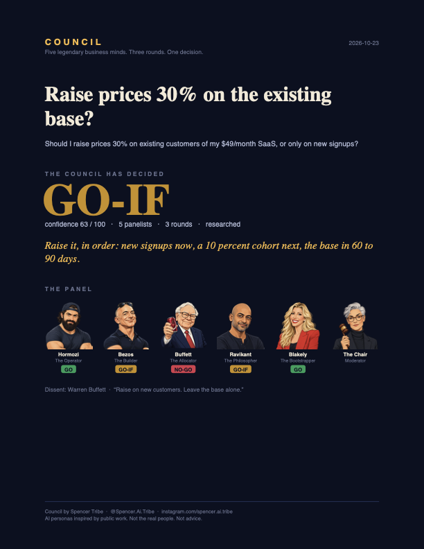

<p align="center">
  
</p>

<h1 align="center">Council</h1>
<p align="center"><b>Five legendary business minds. Three rounds. One decision.</b></p>
<p align="center">A free Claude skill that turns a one-line business question into a three-round debate between AI personas of Alex Hormozi, Jeff Bezos, Warren Buffett, Naval Ravikant and Sara Blakely, with live research, a scorecard, a group verdict, a PDF report and an animated replay you can watch.</p>

<p align="center">
  <a href="#install">Install</a> ·
  <a href="#use-it">Use it</a> ·
  <a href="#what-you-get">What you get</a> ·
  <a href="#how-it-works">How it works</a> ·
  <a href="#faq">FAQ</a>
</p>

---

## Why

Every founder has the same problem: the people who could stress-test a decision are expensive, busy, or dead. Council gives you a room full of the sharpest, most opposed business lenses there are, points them at *your* numbers, and makes them fight it out until they land on a verdict with a recorded dissent and kill criteria. It is a thinking tool. It is also really fun to watch.

```
━━ ROUND 2 · CROSS-EXAMINATION ━━━━━━━━━━━━━━━━━━━━━━━━
 🔴 Buffett 🎯 AGAINST   ↩ Hormozi  "A hundred angry emails is not a spreadsheet line when you are one person."
 🟢 Hormozi    FOR       ↩ Buffett  "Nobody thinks about your bill is not a moat, it is a coma."
 🟡 Bezos      COND.     ↩ Blakely  "Ten calls give you the language. A cohort gives you the truth."
 🟡 Naval      COND.     ↩ Hormozi  "If you cannot say why it is worth $64 in two sentences, it is a tax."
 🟢 Blakely    FOR       ↩ Buffett  "New-customers-only forever is what you do when you are afraid of your customers."
━━━━━━━━━━━━━━━━━━━━━━━━━━━━━━━━━━━━━━━━━━━━━━━━━━━━━━━
```

## Install

**Claude Code**, the simplest way (the skill runs as `/council`):

```bash
git clone https://github.com/Tribespencer/council.git && mkdir -p ~/.claude/skills && cp -R council/skills/council ~/.claude/skills/council
```

Or as a plugin (runs as `/council:council`):

```bash
claude plugin marketplace add Tribespencer/council
```
```bash
claude plugin install council@council
```

**Claude.ai, Claude Desktop, Cowork:** download `council.skill` from the [latest release](https://github.com/Tribespencer/council/releases/latest) and upload it under Settings → Capabilities → Skills. To build it yourself, run `scripts/package.sh`.

The PDF needs `reportlab` (`pip install reportlab`). Without it you still get a print-ready `report.html` and the replay.

## Use it

```
/council Should I raise prices 30% on my existing customers? $49/mo SaaS, haven't touched pricing in 3 years.
```

Or just say it: *"Have the council debate whether I should quit my job to go full time on my newsletter."*

The Chair asks up to three clarifying questions, shows you the brief, and the room convenes. Add a sixth seat with `--with "Steve Jobs"` or "add Mark Cuban to the panel." Skip research with `--no-research`.

## What you get

| Output | What it is |
|---|---|
| **The live board** in your terminal or chat | A stance board after every round, a scorecard at the end. Screenshot-ready. |
| **`report.pdf`** | Cover with the verdict and the panel's votes, the decision page (headline, conditions, actions with timeframes, kill criteria, the dissent), the scorecard, the brief, all three rounds, and the sources. |
| **`replay.html`** | A self-contained animated replay of the debate. Press space to play, `v` to jump to the verdict, `r` for a vertical 9:16 layout made for screen-recording reels. Works offline. |
| **`session.json`** | Everything, structured. Build your own views from it. |

See [`skills/council/assets/example/`](skills/council/assets/example/) for a complete example session.

## How it works

1. **Intake.** Your one-liner, verbatim, plus up to three clarifying questions from the Chair.
2. **Round one, opening positions.** Each panelist argues from their seat's lens and names the facts they want checked.
3. **Research desk.** The open questions go to the web. Every fact used gets a source. No credible source means the panel says so.
4. **Round two, cross-examination.** Everyone must reply to someone by name and attack a specific claim. The Chair appoints a Red Team to try to kill the idea.
5. **Round three, convergence.** Final positions, what moved each panelist, the condition that would flip their vote, and a scorecard.
6. **The verdict.** A fixed decision rule turns five scorecards into GO, NO-GO, GO-IF or SPLIT with a confidence number, the strongest dissent in the dissenter's own words, three to five actions, and two to four kill criteria that would mean the decision was wrong.

In Claude Code the panelists run as parallel subagents, so you can watch five agents spin up and come back disagreeing. On claude.ai they run in one context with strict separation. The debate is the same.

## The boardroom pane (Claude Code mod)

`council-boardroom` is a companion mod for Claude Code: a pane beside the chat that redraws itself as the debate runs. Seats light up with each panelist's stance, the Red Team is marked, the current round shows every pull quote, and the verdict lands with the council's averages, the dissent, and buttons to open the replay and the PDF. It is the thing to screen-record.

```
/plugin install council-boardroom --marketplace Tribespencer/council
```

`/boardroom` opens it by hand, and `/boardroom path/to/session.json` loads a finished run.

## The panel

| Seat | Persona | Lens |
|---|---|---|
| The Operator | Alex Hormozi | Offers, pricing, acquisition math |
| The Builder | Jeff Bezos | Customer obsession, two-way doors, mechanisms |
| The Allocator | Warren Buffett | Moats, margin of safety, avoiding ruin |
| The Philosopher | Naval Ravikant | Leverage, specific knowledge, long games |
| The Bootstrapper | Sara Blakely | Scrappy execution, customer intuition |
| Moderator | The Chair | Runs the room, holds no position |

The personas are caricatures built from each person's public work. They are not the real people, nothing they say is a real quote, and every output says so.

## FAQ

**Is this financial or legal advice?** No. It is a structured argument between AI caricatures. Use it to find the question you had not asked.

**Can I change the panel?** Add one wildcard per run. To change the fixed five, edit `skills/council/personas/` and `assets/avatars/`.

**Does it cost anything?** The skill is free (MIT). Each run uses your own Claude usage. Multi-agent runs in Claude Code use more tokens than single-context runs.

**Why three rounds?** One round is a survey. Two rounds is an argument. Three rounds is a decision.

## Share it

If Council changed a decision for you, post the replay or the cover page and tag **@Spencer.Ai.Tribe** on Instagram. Every PDF and replay carries the handle so the next founder can find it.

---

Built by **Spencer Tribe** · [@Spencer.Ai.Tribe](https://instagram.com/spencer.ai.tribe) · MIT
